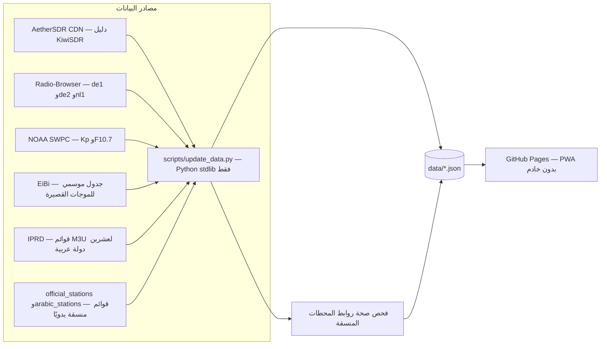

# 📻 Radio Atlas — راديو أطلس

> 🔗 **الموقع المباشر:** <https://samotech.github.io/Radio/>

دليل بحث ذكي بيجمع أجهزة الاستقبال (SDR) ومحطات البث المتاحة أونلاين في مكان واحد، مع تحديث تلقائي مستمر للبيانات — موقع ثابت بالكامل (static PWA) بدون أي خادم خارجي.

## 📊 نظرة سريعة

| البند | التفاصيل |
|---|---|
| 🌐 الموقع | [https://samotech.github.io/Radio/](https://samotech.github.io/Radio/) |
| 📻 محطات البث | أكثر من 50,000 محطة من كل العالم + قوائم منسّقة للإذاعات الرسمية والعربية |
| 🛰️ أجهزة الاستقبال | ~830 جهاز KiwiSDR حول العالم |
| 🔄 التحديث | الإذاعات وفحص الروابط يوميًا · أجهزة SDR والطقس الفضائي والموجات القصيرة كل 6 ساعات |
| 🧱 التقنية | HTML + CSS + Vanilla JS بدون أي مكتبات · Python stdlib للـ crawler · GitHub Pages |
| 🌍 اللغات | عربي (RTL) + English (LTR) |

## ✨ المزايا

### 📻 محطات البث

- كتالوج كامل من Radio-Browser (كل المحطات غير المكسورة) مدموج بالأولوية: الإذاعات الرسمية → المحطات العربية المنسّقة → IPRD → بقية الكتالوج.
- بحث فوري داخل المتصفح بالاسم أو الدولة أو اللغة أو الفئة، مع تطبيع نص عربي (أ/إ/آ، ى/ي، والتشكيل).
- فلاتر قوائم قابلة للبحث (دولة / لغة / فئة) + شرائح سريعة: الكل، المفضلة، عربي، رسمي، أخبار، قرآن، رياضة، موسيقى.
- تشغيل داخلي: بث مباشر MP3/AAC + بث HLS عبر hls.js (بتحميل عند الحاجة، مع تبديل تلقائي بين CDN).
- سلسلة بدائل تلقائية: لو الرابط الأساسي فشل، التطبيق بيجرب بدائل الرابط واحدًا واحدًا بدون تدخل.
- محطات SNRT المغربية (15 إذاعة): توكن EasyBroadcast موقّع تلقائيًا في المتصفح مع تجديد قبل انتهاء صلاحيته.
- شارات حالة الاستجابة من الفحص اليومي: ✔ شغال أو ✖ لا يستجيب (الروابط المحمية بـ 401/403/405 تُحسب شغالة، والمحطات المحمية بتوكن مستثناة من الفحص).
- مفضلة محلية + استكمال آخر محطة كنت بتسمعها + أزرار Media Session + فتح الرابط أو الموقع الرسمي خارجيًا.

### 🛰️ أجهزة الاستقبال SDR

- دليل KiwiSDR الكامل: الحالة (أونلاين/أوفلاين)، عدد المستخدمين، SNR، النطاق، الموقع، الهوائي، إحداثيات GPS.
- فلترة بالنطاق و SNR الأدنى و«فيه مكان فاضي» وفرز بمختلف المعايير.
- استماع داخل التطبيق لواجهة الجهاز (iframe) لأجهزة HTTPS.
- **صوت مباشر تجريبي عبر WebSocket** (بروتوكول KiwiSDR): للأجهزة اللي بتسمح بالاتصال الخارجي (ext_api مفتوح) — مودال بتغيير التردد والوضع AM/USB/LSB/CW، ولو الاتصال فشل خلال 8 ثواني التطبيق بيفتح واجهة الجهاز المدمجة تلقائيًا.

### 📡 أدوات هواة اللاسلكي

- حالة النطاقات: مؤشر Kp وتدفق شمسي F10.7 من NOAA SWPC مع تقييم فتح النطاقات العالية.
- جدول بث الموجات القصيرة النشطة الآن (حتى 3000 إرسال) من جدول EiBi الموسمي.
- عداد زوار متين: إجمالي الزيارات + المتواجدون الآن (نبضات كل دقيقة) — مع كاش محلي 14 يوم وبديل تلقائي لو خدمة العداد وقعت.

### 📱 الواجهة

- عربي/إنجليزي بتبديل فوري (RTL/LTR) + ثيم داكن/فاتح.
- PWA قابلة للتثبيت على الموبايل والديسكتوب، ووضع أوفلاين: network-first مع كاش للبيانات وصفحة أوفلاين احتياطية.

## 🏗️ المعمارية



> أي فشل في أي مصدر بيخلي النظام يحتفظ بآخر لقطة ناجحة — البيانات ما بتتمسش أبدًا عند الفشل.

## 🗃️ ملفات البيانات (data/)

| الملف | المحتوى |
|---|---|
| stations.json | الكتالوج الكامل (~12MB) — ترتيب: رسمية/عربية/IPRD أولاً؛ الحقول: name, url, cc, language, tags, codec, bitrate + حقول اختيارية: fallbacks, website, tokenEndpoint, tokenType |
| kiwisdr.json | ~830 جهاز استقبال (gps, bands, loc, antenna, ext_api) |
| space_weather.json | مؤشر Kp وتدفق F10.7 الشمسي |
| eibi.json | إرسالات الموجات القصيرة النشطة وقت الزحف |
| stream_checks.json | نتائج فحص الروابط اليومي — لكل رابط: alive وcode |

## 🖥️ التشغيل محليًا

```bash
git clone https://github.com/SamoTech/Radio.git
cd Radio
python scripts/update_data.py all       # تحديث كل البيانات
python scripts/update_data.py stations  # كتالوج الإذاعات + فحص الروابط فقط
python scripts/update_data.py sdr       # أجهزة SDR والطقس الفضائي والموجات القصيرة فقط
python -m http.server 8000
# ثم افتح http://localhost:8000
```

الـ crawler يعتمد على Python stdlib فقط — لا يحتاج أي مكتبات خارجية.

## 🚀 النشر والتحديث التلقائي

كل حاجة بتتم في workflow واحد (.github/workflows/update-data.yml):

1. **الجدول:** الإذاعات وفحص الروابط يوميًا (02:17 UTC) · أجهزة SDR والطقس الفضائي وEiBi كل 6 ساعات.
2. **على كل push لـ main:** تحديث شامل (وضع all) + فحص syntax للواجهة (node --check).
3. **الخطوات:** تحديث البيانات → commit لو حصل تغيير فعلي → نشر GitHub Pages في نفس الـ run.

(.github/workflows/deploy.yml موجود للتشغيل اليدوي في الطوارئ فقط.)

## ⚠️ قيود معروفة

- الصوت المباشر عبر WebSocket **تجريبي** — بروتوكول KiwiSDR مُطبّق بأفضل اجتهاد، وبعض الأجهزة بتحتاج باسورد أو بتمنع الاتصالات الخارجية (التطبيق بيرجع للواجهة المدمجة تلقائيًا).
- أجهزة الاستقبال HTTP بتفتح خارجيًا فقط — قيود mixed content بتمنع تضمينها في صفحة HTTPS.
- عداد الزوار من خدمة خارجية (CounterAPI) — الواجهة بتتحمل وقوفه بالكاش والبديل، لكن القيم وقت التقط ممكن تبقى قديمة.
- كتالوج المحطات لسه ملف JSON واحد كبير؛ تقسيمه حسب الدولة محتاج تغيير متوافق في آلية التحميل.
- جدول EiBi بيُجلب من مصدر HTTP فقط، والـ crawler بيحدد الموسم تلقائيًا وبيجرب الموسم الحالي ثم السابق ثم ملف تجميعي.
- فحص الروابط بيتخطى المحطات المحمية بتوكن (مثل easybroadcast) لأن الفحص من سيرفرات GitHub ما بيعرفش يوقّع توكنات.

## 🗺️ خطة المراحل

| المرحلة | المحتوى |
|---|---|
| ✅ MVP | دليل KiwiSDR + محطات FM + تشغيل داخلي + crawler + Pages |
| ✅ المرحلة ٢ (جزئيًا) | صوت KiwiSDR عبر WebSocket (تجريبي، مع احترام ext_api) — باقي: OpenWebRX |
| 3️⃣ | WebSDR + نطاق الطيران |
| 4️⃣ | تنبيهات «فتح النطاقات» (WSPRnet + تاريخ SNR) + SatNOGS + AIS/ADS-B |

## 🔧 بروتوكول التطوير

- أي تعديل على branch منفصل + Pull Request + دمج squash.
- رسائل الـ commits بصيغة conventional: feat / fix / chore / docs.
- البيانات المولّدة لا تُعدّل يدويًا أبدًا — فقط عن طريق الـ crawler.
- الـ crawler عمره ما يمسح آخر لقطة ناجحة عند فشل أي مصدر.
- المحطات الإسرائيلية مستبعدة من الكتالوج نهائيًا (سياسة محتوى).

## 📄 التراخيص والمصادر

بيانات EiBi مجانية للاستخدام وإعادة التوزيع وفق شروط المصدر، مع الإبقاء على نسبة المصدر إلى EiBi. باقي المصادر (KiwiSDR عبر مرآة AetherSDR، Radio-Browser، NOAA SWPC، IPRD) APIs ومنشورات عامة.

---
**SamoTech/Radio** — Cairo 🇪🇬
