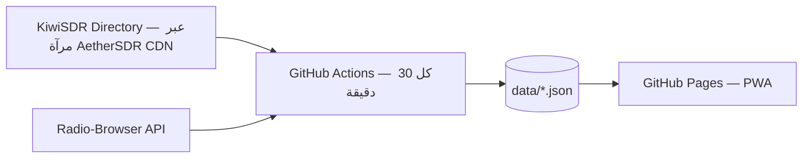

# 📻 Radio Atlas — راديو أطلس

دليل بحث ذكي يجمع أجهزة الاستقبال (SDR) ومحطات البث المتاحة أونلاين في مكان واحد، مع تحديث تلقائي مستمر للبيانات.

> **المرحلة الحالية: MVP** — دليل KiwiSDR كامل + محطات FM/إنترنت بتشغيل مباشر من الموقع.

## المعمارية



### مصادر بيانات أجهزة SDR

1. **الأساسي:** `https://cdn.aethersdr.com/kiwi.json` — مرآة رسمية مفتوحة (CORS) لدليل KiwiSDR العام، بتجدد كل ساعة و بتشتغل حتى لو الأصل وقع (خلال فترة تغييرات سيرفرات KiwiSDR الحالية). حقل `ext_api` بيقول سياسة كل مشغل بخصوص الاتصال من تطبيات خارجية — مهم للمرحلة ٢.
2. **احتياطي:** `rx.kiwisdr.com/json/` — الإندبوينت الأصلي (بيقع و يرجع).

- **الواجهة:** PWA عربية (RTL)، بدون أي dependencies — HTML + CSS + vanilla JS + Service Worker.
- **البحث في محطات FM:** حي ومباشر من Radio-Browser API، مع snapshot احتياطي.

> **ملاحظة تشغيل:** لو فشل سحب مصدر ما، السكربت يحتفظ بآخر لقطة ناجحة ولا يمسح البيانات — ويعيد المحاولة كل ٣٠ دقيقة تلقائيًا.

## الميزات (MVP)

- 🛰️ دليل أجهزة KiwiSDR: الحالة (أونلاين/أوفلاين)، عدد المستخدمين، SNR، النطاق، الموقع، الهوائي، GPS
- 🔎 بحث فوري بالاسم/البلد/الموقع/الهوائي + فلترة بالنطاق و SNR الأدنى و«فيه مكان فاضي»
- 📻 محطات FM/إنترنت: الأكثر استماعًا عالميًا + بحث حي + مشغل صوتي داخلي
- 📱 قابلة للتثبيت كتطبيق (PWA) و تعمل أوفلاين للواجهة

## التشغيل محليًا

```bash
python scripts/update_data.py   # سحب البيانات
python -m http.server 8000       # ثم افتح http://localhost:8000
```

## تفعيل النشر على GitHub Pages (مرة واحدة)

1. من صفحة الريبو: **Settings → Pages**
2. تحت **Build and deployment**: اختر **Source: GitHub Actions**
3. شغّل workflow **Deploy to GitHub Pages** من تبويب Actions (أو دوس أي commit جديد)

الموقع هيكون على: `https://samotech.github.io/Radio/`

## خطة المراحل

| المرحلة | المحتوى |
|---|---|
| ✅ MVP | دليل KiwiSDR + محطات FM + crawler + Pages |
| 2️⃣ | تشغيل صوتي داخلي لأجهزة Kiwi (بروتوكول WebSocket — مع احترام `ext_api` لكل مشغل) + OpenWebRX |
| 3️⃣ | WebSDR + جداول البث الدولي (EIBI) + نطاق الطيران |
| 4️⃣ | تنبيهات «فتح النطاقات» (WSPRnet + تاريخ SNR) + SatNOGS + AIS/ADS-B |

## بروتوكول التطوير

- أي تعديل يتعمل على branch منفصل + Pull Request
- رسائل الـ commits بصيغة conventional (`feat:`, `fix:`, `chore:`)
- البيانات المولدة لا تُعدل يدويًا أبدًا — فقط عن طريق الـ crawler

---
**SamoTech/Radio** — Cairo 🇪🇬


## Discovery and analytics improvements

- Searchable country, language, and category filters.
- Canonical language names and a curated list of common broadcast categories.
- Official/national stations are prioritized in the station catalog.
- A global page-view counter is embedded through CounterAPI.com. Country-level analytics require a separate analytics provider and are not inferred from the total counter.
- The data refresh workflow deploys Pages in the same run after updating the snapshot, avoiding reliance on a second workflow triggered by a push made with the default GitHub Actions token.
